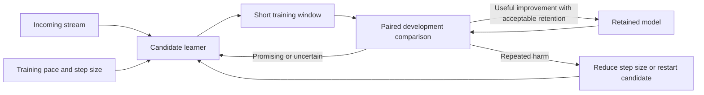

# A controller that can retain improvements and keep learning

Status: design proposal, 2026-10-23. No new training is launched by this note.
N74 continues under its existing frozen protocol. Its development-protection
trajectory has not started at the latest inspected checkpoint; its outcome
remains unknown.

## Diagnosis from the current evidence

The [matched-prefix comparison](../../outputs/single-image-gate-protection-comparison/20261023-33792/report.md)
uses the same parent, seed and stream through 33,792 arrivals. Original J takes
26,385 updates, reaches 64.33% linear accuracy, but suffers a 13.92-point
drawdown. Corrected J takes 225 updates and stays unchanged for a 19,866-arrival
stretch. Corrected covariance takes 420 updates, then keeps none after arrival
9,518. Both corrected policies have lower downside, but neither surpasses the
61.08% parent in that common prefix. All three common-horizon mean accuracies
are below that unchanged parent's readout.

These observations establish restrictive admission behavior, not an intrinsic
inability of the encoder to learn. Intrinsic plasticity loss would require a
controlled intervention that actually trains the stalled model on a learnable
target and compares its learning response with an appropriate reference. It is
premature to reset neurons or optimizer states based on these gates alone.
[Dohare et al.](https://www.nature.com/articles/s41586-024-07711-7) study intrinsic
plasticity loss; that phenomenon is distinct from withholding nearly all updates.

There are at least four separable problems:

1. **Target alignment.** In N73, seven of 17 large-drop intervals improve every
   existing J component. Reconstruction/RankMe/variance are incomplete proxies
   for the requested task accuracy. Reweighting unchanged components cannot
   reverse those seven endpoint rankings.
2. **Action restriction.** We permit a full AdamW singleton step or no step.
   Rejecting a full step does not show that the image is useless under a smaller
   step, another regularizer, or a short sequence of updates.
3. **Horizon mismatch.** A one-image delta-J prediction is being used to manage
   learning over tens of thousands of arrivals. Useful restructuring may require
   multiple steps and temporary task deterioration. Current evidence does not
   establish whether such recoverable paths exist from the stalled states.
4. **Feedback restriction.** A frozen predictor trained on short full-update
   histories encounters long, filtered histories. Deterministic rejection leaves
   missing labels about what rejected images could have done. A covariance cap
   can create a state with little feasible forward motion under the fixed rule.

Keeping the same model unchanged necessarily produces a stable fixed-bank
readout. Reduced drawdown therefore needs to be accompanied by demonstrated new
capability, not only a lower update count. Original J's high peak is also only
one observed excursion; it does not establish that a prospective controller can
reliably capture and preserve that gain.

## The proposed change in control

Control training rate, update size and checkpoint adoption over short windows.
Image selection becomes one optional part of that controller. First establish
useful action responses with simple sampling, before fitting another rich image
selector. N71's nearly identical gate and budget-matched random means, and the
failure to replicate N69's selection gain in N70, argue against assuming that
incoming-image scoring already provides qualified value.

Maintain two complete states:

* A **retained model** supplies the current accepted representation and anchors.
* A **candidate learner** continues exploring a bounded sequence of SSL updates.

Both include encoder, decoder, optimizer buffers, modes and RNG. A rejected
promotion leaves the retained model intact. A promising but unfinished candidate
can continue within a declared exploration budget rather than being reset after
every locally unfavorable image. Extreme deterioration ends that candidate
attempt; it does not automatically invalidate the image stream.

This changes the protection promise. Candidate performance may fluctuate while
the retained model stays fixed. Both trajectories, trial costs and promotion
counts must be reported. Reporting only the retained model could make an
unsuccessful learner look like a successful adaptive system. Zero useful
promotions is a failure to demonstrate adaptation, even if retained drawdown is
zero.

## Give the learner useful actions

For the first implementation, use a small declared action set: pause, a modest
training budget at the nominal learning rate, or the same budget at a lower
learning rate. For example, quarter-rate is a candidate setting to choose on
development histories, not an established optimum. Begin with evenly spaced or
independent sampling. Introduce learned image ranking only after it improves on
simple selection with matched training opportunities.

When testing different step sizes, start each branch from the identical complete
state, use the same arrival/view seed, and perform a real AdamW step at that
learning rate. Scaling a cached raw gradient does not reproduce scaling an AdamW
update, because momentum, preconditioning and weight decay matter. Actual
parameter displacement and the optimizer state must remain consistent.

A failed large step can trigger a smaller-step test. If both fail task checks,
choose another image or pause. Do not spend thousands of trials executing the
same ineffective full-step-versus-hard-cap test without changing the action.

Gradient constraints against retained examples are a later possible action,
inspired by [GEM](https://arxiv.org/abs/1706.08840) and
[A-GEM](https://arxiv.org/abs/1812.00420). A local constraint on actual displacement
`g_dev^T displacement <= budget` approximates limiting development-loss damage.
It does not guarantee refitted-probe accuracy, and applying development-label
gradients to steer encoder updates is a task-informed training intervention.
It must be distinguished from using labels only to decide admission. Smaller
measured steps are a simpler first experiment.

## Give exploration a bounded time horizon

An illustrative window is 32–96 candidate updates, with checks at more than one
horizon. Window size should be selected on development trajectories. Each SSL
step may still use one image. Also report offered-arrival horizons so policies
cannot improve their apparent response by waiting arbitrarily long for data.

Audit three things: terminal task gain, worst within-window deterioration, and
persistence through a subsequent shared continuation. An endpoint-only rule can
miss a deep temporary collapse; an image-by-image monotonicity rule can block a
useful sequence. The acceptable exploration loss and time budget must be explicit.

For a true single-live-model deployment, temporary deterioration is exposed and
the risk allowance must reflect that. With a retained model and a candidate,
more exploratory variation can remain isolated until promotion. This is an
architectural tradeoff, not a free guarantee of continuous improvement.

Conservative-learning research studies checkpoint-level rather than every-step
constraints as a way to improve exploration, for example
[Garcelon et al.](https://ojs.aaai.org/index.php/AAAI/article/view/5812).
Their bandit guarantees do not directly apply: our updates change future encoder
states and future action values. The relevance is the design principle, not a
borrowed guarantee.

## Use task evidence for adoption and health for diagnosis

On a development promotion panel, compare candidate and retained encoders with
the same support panels and query identities. Seek a credible positive balanced
task gain while bounding day/night and class-specific deterioration. One can
write the desired tradeoff as

`gain_H = S_dev(candidate at H) - S_dev(retained at H)`

with subgroup constraints

`S_dev,g(candidate) >= S_dev,g(retained) - tolerance_g`.

Development soft error or margins can supply smoother intermediate feedback;
actual refitted-probe accuracy still decides whether the desired capability
improves. CE alone is insufficient: it improved in five N73 large-drop intervals.
Measured health can identify a collapse or contextual change, but covariance
growth is not by itself evidence of task damage. About 20% of N74's rejected
covariance trials improved immediate development accuracy.

For an optimization formulation, prefer short-horizon task gain minus bounded
task downside and resource cost. Health quantities are secondary state features
and extreme-failure checks, rather than an indefinitely binding warm covariance
ceiling. A soft covariance cost could be studied, but moving the covariance cap
merely because it is frequently hit does not establish that newly allowed motion
is useful.

Use a stable retention panel and a current-distribution development panel if
learning new domains is part of the goal. A historical bank alone may punish
legitimate specialization; a rolling current-only bank can conceal forgetting.
No current-domain label feedback should be assumed when only unlabeled arrivals
are available. In that case, task improvement is harder to validate and remains
a limitation of the controller's information.

The existing rich gate already uses development labels for probes and task
gradients, so a development-based adoption rule is feasible in this experimental
setting. It should be described as task-informed rather than label-free.

## Adapt the controller before making it more complex

Distinguish failure modes and react accordingly:

| Observation | Controller response to test |
|---|---|
| J predictor rejects nearly everything, but independent trials improve development outcomes | Recalibrate on recent trials; increase bounded exploration, not blind live admission. |
| Full steps harm task performance but smaller steps help | Reduce learning rate while preserving training opportunities. |
| Both step sizes repeatedly harm task performance | Pause that action, or test a separately specified retention mechanism. |
| Health changes but task gains persist | Permit the health change; retain it as diagnostic evidence. |
| Response is within probe variability | Gather a bounded confirmation window; avoid changing state solely on tiny score differences. |
| No candidate action improves the task after a declared budget | Treat useful adaptation as unestablished; inspect the learning objective or vehicle. |

A minimum exploration allocation is useful for learning about rejected actions.
It is not a requirement to force a minimum number of harmful production updates.
Exploration labels can come from disposable candidates. The selected action,
probability of selection, learning rate, complete parent state, short-horizon
outcomes and all discarded computation should be logged.

Online prediction can subsequently use these on-policy outcomes, with recent
data weighted appropriately and a small independent audit sample. A skipped
image is not a zero-effect label for hypothetical training. Forecast evaluation
must be prequential: predict first, observe the response, then update the model.
Learn action value and risk over the relevant horizon, rather than only delta J.
Do not introduce a large reinforcement-learning policy before those action values
show useful transferable signal.

## Prevent a better controller from becoming a better validation-set optimizer

Separate control/calibration data, promotion data and final evaluation data.
Repeatedly selecting checkpoints against a fixed promotion bank can overfit it;
fresh panels, declared confirmation budgets and development-held-out histories
are needed. Two adjacent confirmations on the same bank are not independent
replications. The earlier reader qualification found approximately one-point
conditional sensitivity in a different study, so tiny apparent gains should not
be taken as precise universal feedback.

Measure both retained and candidate maximum drawdown, net gain over the unchanged
parent, average and worst-group accuracy, recovery time, accepted updates,
discarded updates, longest learning stall and promotion frequency. Compare
against frozen and a simple paced learner at appropriate budgets, not only
against a volatile full-rate policy. Existing runs can provide descriptive
references; a novel policy's performance needs its own complete trajectory.

Prior replay and adaptive-mixture studies do not establish an adaptive content
advantage. Replay remains an optional retention intervention to test explicitly,
not a mechanism to assume will fix this controller. Likewise, earlier local
half-rate action studies did not qualify a general update-rate rule. A new
stalled-state trial would answer a narrower question about the latest gate's
blocked actions, not overturn those earlier results by assertion.

## The smallest useful next diagnostic

Before another full long run, save a stalled state's complete learning state.
Compare a short declared sequence under no update, paced singleton updates at
the nominal learning rate, and the same sequence at a lower learning rate.
Keep arrival order, chosen images and view randomness paired. Check immediate
development response and persistence after a shared continuation. Use N74's
development-protection result as another diagnostic when it becomes available.

The questions are concrete: Does J reject useful multi-step learning? Does a
smaller step restore useful feasible motion? Does any task gain survive beyond
the first readout? If useful actions exist, build the simple window controller
and retained/candidate separation. If they do not, changing admission thresholds
cannot supply the missing adaptation benefit; investigate the SSL objective,
data composition or training intervention before adding controller complexity.
